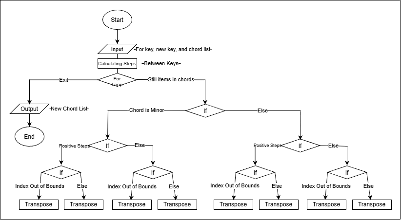

# chord_converter

Python script that takes a musical key, a desired key, and a list of chords and outputs a new list of the corresponding chords in the new key.

## The Problem

When playing guitar, I often find chord charts that are in a key that is very difficult for me to play. Although I can mentally transpose, it takes me a long time and would be easier if I had a way to automate it.

## How It Works

- Takes the current key, the new key, and a list of chords
- Finds the number of steps from the current to new key
- Transposes every chord in the list by that number of steps
- Outputs the list of transposed chords



## Tech Stack

- **Language:** Python

## Setup

```bash
git clone https://github.com/connorallison07-AI/chord_converter
cd chord_converter
python chord_converter.py
```

## Usage

Run the script and provide the 3 input fields

```bash
python chord_converter.py
```

**Input Rules**

- Chords and keys must be all caps with 'm' for minors and only sharps (ex: A, Am, A# not Ab)
- Separate chords with a single space

**Example**

```
What key are the chords in? C
What key do you want the chords in? G
Give the chords in all caps separated by spaces (sharps only): C Am F G
['C', 'Am', 'F', 'G']
['G', 'Em', 'C', 'D']
```

**Limitations**

- Chords beyond major and minor are not supported yet (ex: Cmaj7, A2, Bdim, Cadd9)

## Roadmap

Features you haven't built yet but plan to (pull these from your
"Schedule" quadrant in the Eisenhower Matrix).

- [ ] Complex Chords
- [ ] Capo Fret Output
- [ ] Guitar-friendly Key Recommendations

## Author

Connor Allison, https://github.com/connorallison07-AI
